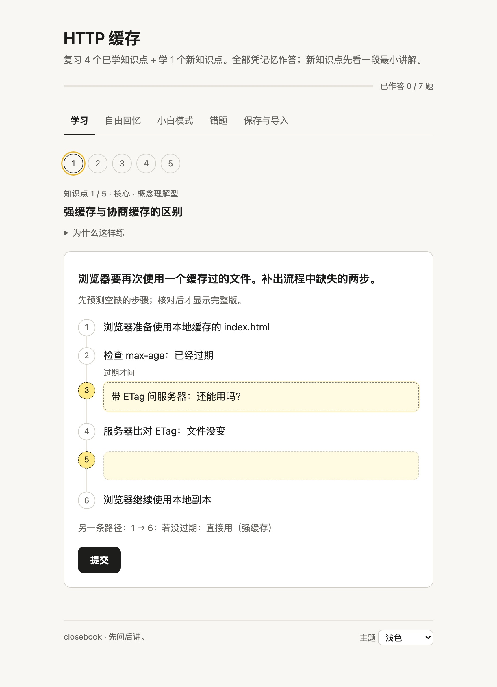
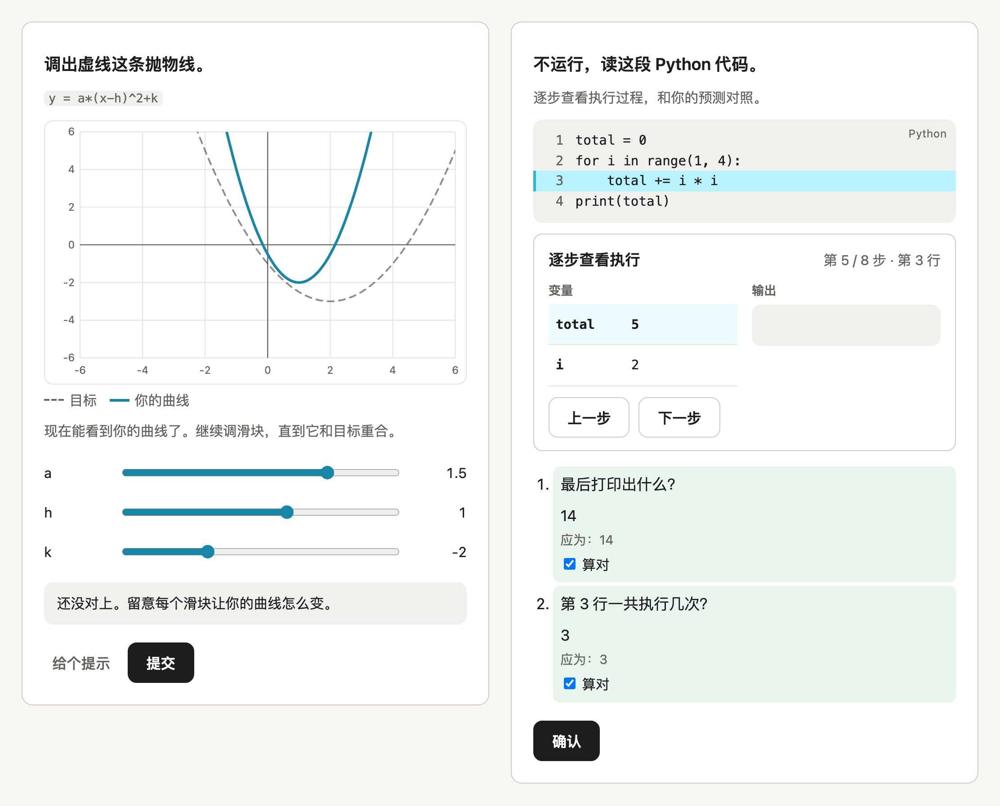

<p align="center"></p>

<h1 align="center">closebook</h1>

<p align="center"><b>Make knowledge actually stick, with the most efficient methods there are.</b><br>
An Agent Skill that applies retrieval practice, spaced review, Feynman explanations and more, choosing the right method for each kind of knowledge.</p>

<p align="center">English · <a href="README.zh-CN.md">简体中文</a> · <a href="LICENSE">MIT</a></p>

---

closebook has one goal: get what you study into long-term memory and real understanding, in the least time.

The most effective methods in learning research share one thing: you produce the answer yourself instead of reading it again. Reading an AI summary feels like learning, but it mostly builds familiarity. So when you ask your assistant to help you study, closebook splits the material into a few knowledge points and has you answer each one first. Then it explains briefly, aimed at your gaps, retests you with the notes closed, and schedules the next review in a progress file you own. Different knowledge gets different methods: recall cards for terms, why-questions and Feynman explanations for concepts, predict-then-verify for procedures. Your time goes to what you don't know yet.

It is one skill folder ([`skills/closebook`](skills/closebook)) that works on Claude, ChatGPT / Codex, Gemini and any assistant you can paste instructions into. The teaching flow needs nothing but plain text. Scripts and the HTML practice page are optional extras.

## Ask your agent to install it

**[Download the installation prompt (.md, English)](https://github.com/sheepxux/closebook/releases/download/v0.2.0/closebook-install-prompt.md?v=149a229)**, attach it to your agent, and say: **“Install closebook by following the prompt in this file.”**

The prompt is in English and requests progress updates and results in Simplified Chinese unless you ask for another language. It includes host detection and verification. You can also [read and copy the prompt](closebook-install-prompt.md).

Agents with access to a local skill directory can install it. Account-based apps may still need you to upload or enable the skill; chat-only assistants use the text fallback. [Installation workflow and limits](INSTALL.md) (Chinese).

## What a session looks like

> **You:** Quiz me on my HTTP caching notes. *(notes attached)*
>
> **closebook:** Here's how I'd split this:
> 1. [important · factual] Cache-Control directives and the 304 status: quick recall
> 2. [core · conceptual] Strong vs. negotiated cache: predict the request flow, then why-questions
> 3. [core · judgment] Caching strategy per file type: pick and justify
>
> One reply is enough: time today (15 / 30 / 60 min)? How familiar (new / seen it but shaky / fairly familiar)? Any change to the list?
>
> **You:** 30, shaky, go.
>
> **closebook:** Notes closed, please. "I don't know" is a fine answer here.
> What does `Cache-Control: no-cache` tell the browser? Answer + confidence 1–3 (1 = guessing, 3 = certain).
>
> **You:** Don't cache it at all. 3
>
> **closebook:** You were certain, and this is the most common mix-up, so it's worth fixing now. `no-cache` *does* store the response; the browser just has to check with the server before every reuse. "Don't store at all" is `no-store`. Example: `index.html` with `no-cache` sends a conditional request on each visit, and if nothing changed the server answers with a tiny `304`.
> Retest, notes still closed: a response has `no-store` and the user reloads the page. Can the browser get a `304`? Why or why not? Answer + confidence.

At the end you get a short synthesis (explain the topic in your own words, or list what you remember), a review list with real dates such as `2026-11-01: point 1 (high-confidence error first)`, and your progress, either as a file or as a compact JSON block to paste back next time.

## What it does

- **Output first.** Diagnose, then give minimal feedback (what's right, what's missing, one example and one principle), then retest closed-book. It never shows the answer to a question you haven't answered, and asks one open question at a time.
- **Picks the method per knowledge point.** Facts and glossaries get retrieval, flashcards and memory aids, with no forced analogies. Concepts get why-questions and Feynman explanations. Procedures get predict-then-verify. Architectures get a diagram you fill in before seeing it. Contested material gets open arguments judged on coherence, with no answer key and no multiple choice.
- **Honest feedback.** Encouraging, but a wrong answer is called wrong. A confident wrong answer is flagged and reviewed first.
- **Spaced review.** Leitner boxes (1 → 3 → 7 → 14 → 30 days), replayed from your answer history, with interleaving and calibration feedback.
- **Plain Talk Mode (小白模式).** Say "plain talk", "ELI5" or "说人话" for an everyday-language version: a conclusion, an analogy *and where it breaks*, an example and a pitfall, followed by a closed-book recall. Precise definitions get no analogy.
- **Respects you.** Ask only for a summary and it offers active learning once, in one sentence, then does what you chose. If you insist on a method it thinks fits badly, it explains once, then complies and notes it in your progress.
- **Scenario modes** for exam prep, coding, language learning and conceptual understanding.
- **Optional HTML practice page.** A self-contained page with fill-in diagrams, multiple choice with an explanation for every option, flashcards, comparison tables, confidence ratings and an export you can merge back into your progress. It also has forms for particular subjects: code tracing and a simulated terminal for programming, number answers and adjustable graphs for maths and science, parameter labs, ordering tasks and cloze passages.

## Install

Download the ready-made [standard ZIP](https://github.com/sheepxux/closebook/releases/latest/download/closebook.zip) or [Gemini ZIP](https://github.com/sheepxux/closebook/releases/latest/download/closebook-gemini.zip). Use these directly for the upload steps below.

The copy commands below assume a source checkout. Developers can also build the ZIPs (Python 3.8+, standard library only):

```bash
python3 tools/package_skill.py   # writes dist/closebook.zip and dist/closebook-gemini.zip
```

| Platform | How | Guide |
|---|---|---|
| Claude Code | `cp -R skills/closebook ~/.claude/skills/` | [adapters/claude.md](adapters/claude.md) |
| claude.ai / Claude Desktop | Turn on code execution, then Customize → Skills → upload `dist/closebook.zip` | [adapters/claude.md](adapters/claude.md) |
| Codex CLI / IDE | `cp -R skills/closebook ~/.agents/skills/`, then `$closebook` | [adapters/chatgpt-codex.md](adapters/chatgpt-codex.md) |
| Hermes Agent | Install the complete skill under the active profile's `HERMES_HOME/skills/`; documented, not tested hands-on | [adapters/hermes.md](adapters/hermes.md) |
| ChatGPT (Business, Enterprise, Healthcare, Edu) | Plugins → Skills → Create → upload `dist/closebook.zip` | [adapters/chatgpt-codex.md](adapters/chatgpt-codex.md) |
| Gemini Apps | Create a skill from `dist/closebook-gemini.zip` | [adapters/gemini.md](adapters/gemini.md) |
| Gemini CLI | `cp -R skills/closebook ~/.gemini/skills/` | [adapters/gemini.md](adapters/gemini.md) |
| Anything else | Paste the instruction block into custom instructions, a Gem or a project | [adapters/generic.md](adapters/generic.md) |

Install paths were checked against official docs on 2026-10-31 ([log](docs/platform-verification.md)). Platforms change quickly, so each guide marks every claim as verified (with a source) or unverified.

**Try it:** "Quiz me on these notes", "Help me prepare for my exam on Friday", "考考我", or come back with your progress file and say "review". To get a summary without being quizzed, just ask for a summary and decline the offer.

## Progress you own

Progress is a JSON file ([schema](skills/closebook/schemas/progress.schema.json)): knowledge points, every attempt, error types, Leitner boxes and next review dates. In environments with files the skill keeps it in `closebook-progress/<topic>.json` and updates it through a small, dependency-free tool:

```bash
python3 skills/closebook/scripts/progress_tool.py due closebook-progress/http-cache.json --date 2026-11-01
python3 skills/closebook/scripts/progress_tool.py schedule closebook-progress/http-cache.json
python3 skills/closebook/scripts/progress_tool.py import-session closebook-progress/http-cache.json export.json
python3 skills/closebook/scripts/progress_tool.py apply-grading closebook-progress/http-cache.json grading.json
```

In chat-only apps you get a compact JSON block at the end of each session. Paste it back next time. The skill never claims to remember across chats.

## The practice page

<p align="center"></p>

When the environment can produce a file, the skill writes the lesson data and [`build_lesson.py`](skills/closebook/scripts/build_lesson.py) embeds it into a [template](skills/closebook/assets/lesson-template.html). The result is a single offline HTML file with no network requests, light and dark themes, keyboard support and a mobile layout. Open [`examples/http-cache-lesson.html`](examples/http-cache-lesson.html) to try one. Without file support, the same questions run in plain text.

The page checks anything with an answer key itself (multiple choice, blanks, numbers, orders, commands, graph targets); flashcards and written answers start as self-checks. Written answers can go through the coach: export "my answers", paste them into the chat, and paste the grading block you get back into the page. Each answer then shows the coach's verdict and feedback, and the mistakes list and review schedule follow it. It's a copy-and-paste round trip rather than live grading, so the page stays offline and needs no API key.

### Forms for particular subjects

<p align="center"></p>

The knowledge type still picks the method; the subject suggests which form to try first. Each form asks you to produce or predict something before it shows the answer:

| Subject | Form | What you do |
|---|---|---|
| Programming | `code_trace` | Predict what the code prints, then step through it line by line with the variables shown |
| Programming | `order_steps` (Parsons) | Put code lines in order; some lines don't belong |
| Command line, git | `terminal` | Type each command into a simulated terminal (it only knows the expected commands and runs nothing) |
| Maths, physics, finance | `numeric` | Type a number or an expression like `3/4`; see the worked solution |
| Maths, physics, economics | `graph` | Set the sliders to reproduce a target curve (your curve appears only after you check), or predict what a change will do, then explore |
| Science mechanisms | `simulation` | Predict first; then the sliders, readouts and graph unlock |
| Biology, law, languages | `cloze_passage` | Fill several blanks in a passage, with an optional word bank |
| Languages, history, procedures | `order_steps` | Build a sentence from word tiles, or put events or steps in order |

Open [`examples/subject-widgets-lesson.html`](examples/subject-widgets-lesson.html) for one of each. The research behind each choice, and how every form falls back to plain text, are in [`interaction-fit.md`](skills/closebook/references/interaction-fit.md).

## Repository layout

```
skills/closebook/        the skill (this folder is what gets installed)
  SKILL.md               lean core: priorities, flow, routing
  references/            teaching flow, method and interaction fit, modes, Plain Talk, 12 methods
  schemas/               progress, lesson-data, session-export and grading schemas + examples
  scripts/               progress_tool.py, build_lesson.py (Python 3.8+, stdlib only)
  assets/                lesson-template.html
  agents/openai.yaml     Codex display metadata
  evals/                 22 behaviour evals (not shipped in the ZIPs)
adapters/                per-platform install and capability notes
docs/                    design decisions, platform verification log, validation report, eval results
examples/                built practice pages
tests/                   unit, packaging and browser tests
tools/package_skill.py   builds the upload ZIPs
```

## Development

```bash
python3 -m unittest discover -s tests
```

The browser tests drive the practice page in headless Chromium and are skipped if Playwright isn't installed:

```bash
pip install playwright && python3 -m playwright install chromium-headless-shell
```

Behaviour evals live in [`skills/closebook/evals`](skills/closebook/evals) in the skill-creator format. They cover each scenario mode, summary-only requests, returning with a progress file, glossaries, contested material, user overrides, mixed material, architecture diagrams, plain-text-only environments, Plain Talk and chat export. The latest results and what couldn't be verified are in the [validation report](docs/validation-report.md). See [CONTRIBUTING.md](CONTRIBUTING.md) before changing the skill text.

## License

[MIT](LICENSE) © sheepxux
