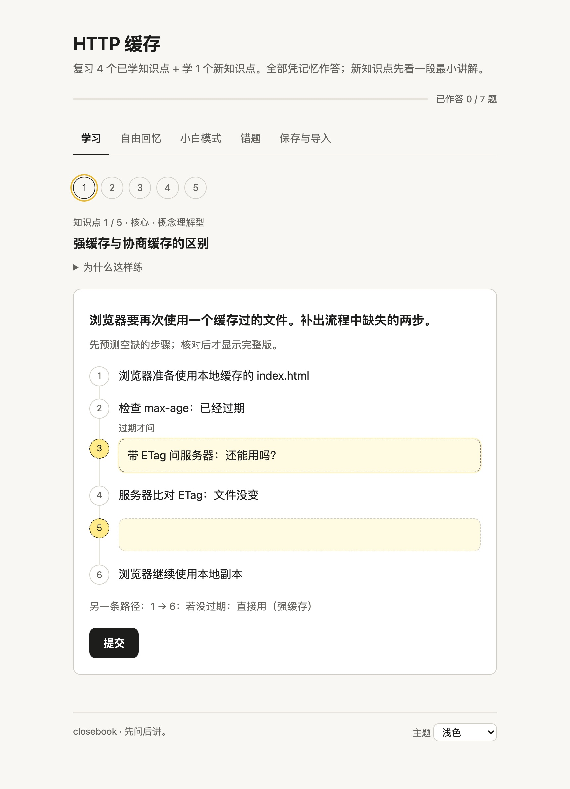

<p align="center"></p>

<h1 align="center">closebook</h1>

<p align="center"><b>让知识真正进入大脑，用效率最高的方法。</b><br>
一个 Agent Skill：主动回忆、间隔复习、费曼讲解……按知识类型选出最有效的学法。</p>

<p align="center"><a href="README.md">English</a> · 简体中文 · <a href="LICENSE">MIT</a></p>

---

closebook 只有一个目标：让你学的东西真正记住、真正理解，而且花的时间最少。

学习研究里效果最好的方法都有一个共同点：要你自己把答案"想出来"，而不是再读一遍。读 AI 写的总结感觉像在学习，其实多半只是"眼熟"。所以你让助手帮你学时，closebook 会先把材料拆成几个知识点，每个点先让你作答，再针对你的漏洞简短讲解，然后合上资料重测，并把下次复习时间写进一份由你保存的进度文件。不同知识用不同方法：术语用回忆卡片，概念用追问和费曼讲解，操作用先预测再验证，时间花在你还没掌握的地方。

整个 skill 就是一个文件夹（[`skills/closebook`](skills/closebook)），可用于 Claude、ChatGPT / Codex、Gemini，以及任何能粘贴自定义指令的助手。教学流程只需要纯文本；脚本和 HTML 练习页都是可选的增强。

## 一次学习是什么样的

> **你：** 考考我这份 HTTP 缓存笔记。*（附上笔记）*
>
> **closebook：** 我把它拆成这几个点：
> 1. [重要 · 事实型] Cache-Control 指令与 304 状态码：快速回忆
> 2. [核心 · 概念型] 强缓存 vs 协商缓存：先预测请求流程，再问为什么
> 3. [核心 · 判断型] 按文件类型选缓存策略：做选择并说理由
>
> 回一条就行：今天有多少时间（15 / 30 / 60 分钟）？熟悉程度（没学过 / 学过但不牢 / 比较熟）？清单要改吗？
>
> **你：** 30 分钟，不太牢，开始吧。
>
> **closebook：** 请先合上笔记。这里答"不知道"完全没问题。
> `Cache-Control: no-cache` 是在告诉浏览器什么？请回答，并附上把握程度 1–3（1 = 猜的，3 = 很确定）。
>
> **你：** 完全不缓存。3
>
> **closebook：** 你很确定，而这恰好是最常见的混淆，值得现在纠正。`no-cache` 其实**会**存下响应，只是每次复用前都要先问服务器；"完全不存"的是 `no-store`。例子：`index.html` 设成 `no-cache`，每次访问都会发一个条件请求，文件没变时服务器只回一个很小的 `304`。
> 重测，继续合着笔记：某个响应带 `no-store`，用户刷新页面，浏览器能拿到 `304` 吗？为什么？请附上把握程度。

结束时会有一段简短的综合（用自己的话把整个主题讲一遍，或列出你记得的内容），一份带真实日期的复习清单，例如 `2026-11-01：第 1 点（高信心错误优先）`，以及你的进度：要么是一个文件，要么是一段紧凑的 JSON，下次粘贴回来即可。

## 它做什么

- **先输出。** 诊断，然后是最少的反馈（哪里对、缺了什么、一个例子加一句原理），再合上资料重测。你没答的题，它绝不提前给答案；每次只问一个开放问题。
- **按知识点选方法。** 事实和术语表用回忆、闪卡和记忆技巧，不硬套类比。概念用"为什么"追问和费曼讲解。操作步骤用先预测再验证。架构先让你填图，再给完整图。有争议的内容用开放论证，按论证是否自洽来评，不设标准答案，也不出选择题。
- **诚实的反馈。** 语气鼓励，但答错就是答错。高信心答错会被标记，复习时排在最前。
- **间隔复习。** Leitner 盒子（1 → 3 → 7 → 14 → 30 天），由作答历史重放计算，支持交错练习和信心校准反馈。
- **小白模式（Plain Talk）。** 说"说人话""简单点""小白模式"，就会切换成大白话：结论、类比**以及类比不成立的地方**、例子、常见坑，讲完一定合上做一次回忆。精确定义不做类比。
- **尊重你的选择。** 只要总结时，它用一句话提议一次主动学习，然后照你的选择办。你坚持用它认为不合适的方法，它只解释一次，然后照做，并记进进度里。
- **场景模式：** 备考、编程、语言学习、概念理解。
- **可选的 HTML 练习页。** 单文件页面，包含填空流程图、每个选项都有解析的选择题、闪卡、对比表、信心评分，以及可以合并回进度文件的导出。

## 安装

先打包上传用的 ZIP（Python 3.8+，只用标准库）：

```bash
python3 tools/package_skill.py   # 生成 dist/closebook.zip 和 dist/closebook-gemini.zip
```

| 平台 | 方法 | 说明 |
|---|---|---|
| Claude Code | `cp -R skills/closebook ~/.claude/skills/` | [adapters/claude.md](adapters/claude.md) |
| claude.ai / Claude Desktop | 打开代码执行，然后 Customize → Skills → 上传 `dist/closebook.zip` | [adapters/claude.md](adapters/claude.md) |
| Codex CLI / IDE | `cp -R skills/closebook ~/.agents/skills/`，然后用 `$closebook` | [adapters/chatgpt-codex.md](adapters/chatgpt-codex.md) |
| ChatGPT（Business、Enterprise、Healthcare、Edu） | Plugins → Skills → Create → 上传 `dist/closebook.zip` | [adapters/chatgpt-codex.md](adapters/chatgpt-codex.md) |
| Gemini Apps | 用 `dist/closebook-gemini.zip` 创建 skill | [adapters/gemini.md](adapters/gemini.md) |
| Gemini CLI | `cp -R skills/closebook ~/.gemini/skills/` | [adapters/gemini.md](adapters/gemini.md) |
| 其他助手 | 把指令块粘贴到自定义指令、Gem 或项目里 | [adapters/generic.md](adapters/generic.md) |

安装路径已在 2026-10-31 对照官方文档核实（[记录](docs/platform-verification.md)）。平台变化很快，所以每份说明都给每条结论标了"已核实（附来源）"或"未核实"。

**试一试：**"考考我这份笔记""帮我准备周五的考试""Quiz me on these notes"，或者带着进度文件回来说"复习"。只想要总结的话，直接要总结，然后拒绝它的提议即可。

## 进度由你保存

进度是一个 JSON 文件（[schema](skills/closebook/schemas/progress.schema.json)），记录知识点、每次作答、错误类型、Leitner 盒子和下次复习日期。在能读写文件的环境里，skill 会把它存到 `closebook-progress/<主题>.json`，并通过一个无依赖的小工具更新：

```bash
python3 skills/closebook/scripts/progress_tool.py due closebook-progress/http-cache.json --date 2026-11-01
python3 skills/closebook/scripts/progress_tool.py schedule closebook-progress/http-cache.json
python3 skills/closebook/scripts/progress_tool.py import-session closebook-progress/http-cache.json export.json
python3 skills/closebook/scripts/progress_tool.py apply-grading closebook-progress/http-cache.json grading.json
```

在只能聊天的应用里，每次结束时你会拿到一段紧凑的 JSON，下次粘贴回来即可。skill 不会假装能跨对话记住你。

## 练习页

<p align="center"></p>

当环境能生成文件时，skill 写出课程数据，由 [`build_lesson.py`](skills/closebook/scripts/build_lesson.py) 嵌入[模板](skills/closebook/assets/lesson-template.html)，得到一个离线可用的单文件 HTML：不发任何网络请求，支持浅色/深色主题、键盘操作和手机布局。可以直接打开 [`examples/http-cache-lesson.html`](examples/http-cache-lesson.html) 试试。没有文件能力时，同样的题目以纯文本进行。

选择题和填空由页面自己判对错；闪卡和文字作答先由你自评。文字作答还可以交给教练批改：导出“我的作答”，粘贴到对话；再把教练回复的批改结果粘回页面。每题会显示教练的判定和点评，错题本和复习计划也随之更新。这是一次复制粘贴的来回，不是实时批改，所以页面仍然离线、不需要 API Key。

## 仓库结构

```
skills/closebook/        skill 本体（安装的就是这个文件夹）
  SKILL.md               精简核心：优先级、流程、路由
  references/            教学流程、方法与交互适配、场景模式、小白模式、12 种方法
  schemas/               进度、课程数据、会话导出、批改结果的 schema 和示例
  scripts/               progress_tool.py、build_lesson.py（Python 3.8+，仅标准库）
  assets/                lesson-template.html
  agents/openai.yaml     Codex 展示信息
  evals/                 22 个行为评测（不打进 ZIP）
adapters/                各平台安装与能力说明
docs/                    设计决策、平台核实记录、验证报告、评测结果
examples/                一个生成好的练习页
tests/                   单元测试、打包测试、浏览器测试
tools/package_skill.py   生成上传用 ZIP
```

## 开发

```bash
python3 -m unittest discover -s tests
```

浏览器测试会在无头 Chromium 里操作练习页；没装 Playwright 时自动跳过：

```bash
pip install playwright && python3 -m playwright install chromium-headless-shell
```

行为评测在 [`skills/closebook/evals`](skills/closebook/evals)，采用 skill-creator 格式，覆盖各场景模式、只要总结、带进度文件回来复习、术语表、争议材料、用户坚持不合适的方法、混合材料、架构图、纯文本环境、小白模式和聊天导出。最新结果以及未能核实的部分见[验证报告](docs/validation-report.md)。修改 skill 文本前请先看 [CONTRIBUTING.md](CONTRIBUTING.md)。

## 许可证

[MIT](LICENSE) © sheepxux
